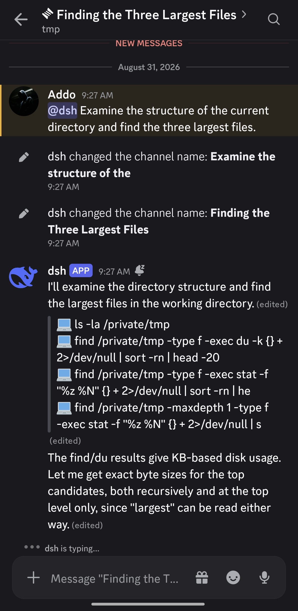

# DSH Discord

A Discord bridge for **DeepSeek Harness 0.2.2 desktop**: mention the bot, pick any DSH
conversation (or start a new one), and follow it live in a Discord thread. The thread's name
tracks the conversation title, and messages typed in the thread go back to the same conversation.

> **Fork.** This project is a fork of
> [addozhang/dsh-discord](https://github.com/addozhang/dsh-discord) (MIT), a mature Discord
> adapter for DeepSeek Harness. This fork targets the DSH **0.2.2-rc.1** desktop host and a
> single-user workflow, and adds conversation picking, attach-to-existing, thread-title sync, a
> one-time token import, and live-delta rendering for that host. It is not affiliated with
> addozhang, DeepSeek, or Discord.

The headline difference is the workflow: upstream always creates a new conversation from a
mention and resumes old ones through a slash command. Here a mention can pick any recent
conversation in a workspace, follow it in the thread, and keep its Discord thread name in sync.

## Verified vs inherited

This fork separates what it has personally verified from what it inherited. "Verified" means it
was exercised on a real Discord guild against a 0.2.2-rc.1 host; "inherited" means the upstream
adapter implements it and its upstream tests cover it, but this fork has not re-verified it here.

| Behavior | State |
|---|---|
| Conversation picker: mention → workspace → recent conversations or **New conversation** | **verified here** |
| Attach to an existing conversation, backfill recent turns (~20), follow live | **verified here** |
| Bound-channel mention follows the workspace's newest conversation | **verified here** |
| Thread title follows the conversation title; attach renames the thread immediately | **verified here** |
| Live answer deltas on 0.2.2-rc.1 (`assistant-stream` bridge) | **verified here** |
| A failed turn posts one visible system line | **verified here** |
| One-time bot-token import and guild/member allowlist seeding | **verified here** |
| Nine slash commands registered; gateway READY; category and control channel provisioned | **verified here** |
| Settings card registers as a `settings.section` page (title **DSH Discord**) | **verified here** |
| Approval buttons, question selects/modals, `/steer`, `/stop`, `/queue`, `/model`, `/permission` | inherited (upstream tests; not re-verified here) |
| Image and text-file attachments; restart catch-up; persistent bindings | inherited (upstream tests; not re-verified here) |
| Multi-user conversation sharing | not supported (design position) |

The evidence behind the **verified here** rows, with generic IDs and message contents, is in
[`docs/verification.md`](docs/verification.md).

## Requirements

- **DeepSeek Harness desktop 0.2.2-rc.1.** The package's dependency matrix is pinned to that host
  line. A different host line needs a matching matrix and a rebuild.
- **Node.js `^22.19.0 || >=24`** for building.
- **A Discord application with a bot user** and the **MESSAGE CONTENT** privileged intent enabled
  (Developer Portal → your application → Bot → Privileged Gateway Intents).
- **A bot invite** with: View Channels, Manage Channels (the adapter provisions its category and
  home channel), Send Messages, Create Public Threads, Send Messages in Threads, Attach Files,
  Read Message History.

## Build

```sh
pnpm install
pnpm typecheck
pnpm lint
pnpm test
pnpm build        # lib/ plus the browser card bundle
pnpm pack --pack-destination /tmp
```

`pnpm build` is required before installing: the package ships `lib/`, and a fresh checkout has no
`lib/` directory.

## Install

**Primary: plugin manager, from a DSH session.** Build first, then call the `plugin_manager` tool
with `action: "install_bundle"` and `target` set to this checkout (an absolute directory path) or
to a packed `file:` tarball. The plugin manager installs the bundle into the running profile and
registers its patch row.

**Alternative: CLI install, with the host stopped.** The running host holds the profile lock.

```sh
pnpm pack --pack-destination /tmp
dsh plugin --profile <profile> add file:/tmp/aporb-dsh-discord-0.2.2.tgz
```

Restart the DeepSeek Harness desktop App after installing or replacing the plugin. The host reads
the plugin tree, credentials, and package metadata at start.

## First run

1. Restart the App, then open **Settings → DSH Discord**.
2. **Token.** On first start the adapter tries a one-time import of `DISCORD_BOT_TOKEN` from a
   legacy bot env file. The default path is `~/.hermes/.env`; set
   `DSH_DISCORD_BOOTSTRAP_ENV=/path/to/env` before booting to point at a different file. The value
   is written to the DSH credential service as `DSH_DISCORD_BOT_TOKEN` and never to settings or
   logs. If the import does not happen, paste the token in the card and press **Connect**.
3. **Allowlists.** On the same first start, when both lists are still empty, the adapter seeds
   `allowedGuildIds` from `DISCORD_HOME_CHANNEL`'s guild and `memberUserIds` from
   `DISCORD_ALLOWED_USERS`. Existing values are never overwritten; the card and the profile patch
   stay authoritative afterwards.
4. **Mention.** Send `@your-bot hello` in any server channel. In an unbound channel the bot opens a
   thread and asks for a workspace, then a conversation (or **New conversation**). In a channel
   bound with `/project bind`, the mention follows that workspace's newest conversation.

Settings are ordinary profile overrides, for example:

```yaml
# <profile>/cordis.patch.yml
- id: dsh-discord
  config:
    allowedGuildIds: ["123456789012345678"]
    memberUserIds: ["234567890123456789"]
```

## Commands

| Command | Where | What |
|---|---|---|
| `/project list` | any channel | list registered workspaces, with optional autocomplete filter |
| `/project bind` | any channel | bind this guild to a workspace and provision its home channel (workspace administrators) |
| `/project info` | any channel | show this channel's workspace binding |
| `/session pick` | any channel or thread | open the conversation picker in a fresh or current thread (fork addition) |
| `/session resume` | project channel | resume a past session of this workspace into a new thread |
| `/queue list` / `/queue remove` | session thread | inspect or trim the pending queue |
| `/steer` | session thread | steer the running turn |
| `/stop` | session thread | cancel the running turn |
| `/model show` / `/model select` | session thread | show or switch the session model |
| `/permission show` / `/permission set` | session thread | show or switch the permission preset; `danger-full-access` asks for button confirmation |
| `/info` | any channel | adapter version, connection state, and project link |
| `/guild forget` | any channel | remove adapter records for this guild (Host operators only) |

`/session new` does not exist; the mention is the new-conversation path.

## Settings reference

All keys live in the `dsh-discord` settings namespace. The card edits the token and connection
surface, the allowed servers, and the archive window; everything else is set in the profile patch.

| Key | Default | Meaning |
|---|---|---|
| `enabled` | `false` | Adapter master switch (the card's Connect starts the runtime) |
| `allowedGuildIds` | `[]` | Guild allowlist; the outer authorization boundary |
| `memberUserIds` / `memberRoleIds` | `[]` | Member-level authorization inside an allowed guild |
| `administratorUserIds` / `administratorRoleIds` | `[]` | Workspace-administrator level, needed for `/project bind` |
| `deniedUserIds` / `deniedRoleIds` | `[]` | Deny entries; they win over every grant |
| `hostOperatorUserIds` | `[]` | Host operators (`/guild forget`; model/permission switching when restricted) |
| `defaultVerbosity` | `essential-tools` | Tool-activity detail: `text-only`, `essential-tools`, or `full-tools` |
| `threadAutoArchiveMinutes` | `1440` | Thread auto-archive: `60`, `1440`, `4320`, or `10080` |
| `streamUpdateIntervalMs` | `800` | Coalescing budget for stream edits, 250–10000 |
| `typingIntervalMs` | `7000` | Typing-indicator heartbeat, 1000–30000 |
| `approvalTimeoutMs` | `600000` | Approval deadline, 30000–86400000; overdue approvals auto-reject |
| `questionTimeoutMs` | `1800000` | Question deadline, 30000–86400000; expiry cancels the owning turn |
| `modelSelectOperatorOnly` | `false` | Restrict `/model select` to `hostOperatorUserIds` |
| `permissionSelectOperatorOnly` | `true` | Restrict `/permission set` to `hostOperatorUserIds` |

Discord IDs must be snowflakes (17–20 digits).

<p align="center">
  <br>
  <em>Upstream render. The conversation picker and thread-title sync are not shown in this screenshot.</em>
</p>

## Design notes

- **Single-writer conversations.** A DSH session has no user dimension: `session.create` takes no
  user id and `session.prompt` carries only text and image parts. One bot token maps to one running
  host fiber. Input therefore carries no Discord author identity, and sharing one conversation
  across several members is out of scope. The routing layer does not yet enforce single-writer
  input; any authorized member's message in a bound thread is submitted as a prompt.
- **At-most-once delivery.** Host submission is at-most-once with unknown-preserving reconciliation.
  An ambiguous delivery is never blindly resent; a nonce correlates a submit attempt with its
  outcome.
- **Opaque component ids.** DSH identifiers never reach the Discord wire. Component ids are
  registry keys that carry no host identifier, and picker select values are positional indices.
- **English-only.** One locale file, all copy in English; the upstream `language` setting is gone.
- **Live deltas on 0.2.2-rc.1.** That host emits no durable `assistant/chunk` events. Text deltas
  arrive as `follow` `assistant-stream` frames; the fork re-shapes them into the renderer's durable
  vocabulary, including the snapshot baseline when a thread attaches mid-turn.
- **Thread titles.** The renderer consumes the durable `session/title` event and the translated
  title projection. Renames are deduplicated against the last applied title and the thread's
  current wire name, because Discord allows roughly two renames per ten minutes.
- **Interactive updates.** A picker update is answered through the Discord interaction when
  possible and falls back to posting a fresh message in the thread when the form body is rejected.

## Known limitations

- **Multi-user sharing is not supported.** See the design note; the boundary is not yet enforced.
- **Inherited behaviors are not re-verified here.** The table above marks approval/question buttons,
  queue and turn control, model and permission switching, and attachments as inherited from
  upstream.
- **`/preset`, `/skill`, and `/host` are not registered.** Their modules exist and remain unit-tested
  upstream; the router does not wire them.
- **Verbosity is one global setting.** There is no per-thread verbosity.
- **Attachment scope.** Only images and text-capable files reach the model. Text files are capped at
  256 KiB each and 512 KiB per message (at most 10), must be strict UTF-8, and are sent as plain
  text. PDFs, office documents, archives, and other binaries are not parsed; they produce a notice.
- **Picker bounds.** At most 25 workspaces are listed; one workspace lists at most 24 recent
  conversations plus **New conversation** (Discord's select-menu ceiling).
- **Thread rename throttle.** Discord allows roughly two thread renames per ten minutes. The
  adapter skips no-op renames, but a burst of title changes can leave an older name until the next
  change.
- **Token import source.** The one-time import expects a legacy env file at `~/.hermes/.env` unless
  `DSH_DISCORD_BOOTSTRAP_ENV` points elsewhere. Without it, set the token in the card.
- **No DMs.** Commands are guild-only.
- **GitHub-only distribution.** No npm publish pipeline; install from a checkout or a packed tarball.

## Development

```sh
pnpm typecheck     # tsc --noEmit
pnpm lint          # eslint --max-warnings 0
pnpm test          # vitest (98 files, 930 tests at 0.2.2)
pnpm build         # lib/ plus the browser card bundle
```

Debugging: set `DSH_DISCORD_TRACE=1` before starting the host to print mux frames, drop points, and
delivery outcomes to stderr. Boot milestones are appended as JSON lines to
`$TMPDIR/dsh-discord-diag.log`; set `DSH_DISCORD_DIAG=0` to silence it.

Packaging rule: never add a `@deepseek-ai/dsh-*` package to `dependencies`. The host's
exact-version gate disables plugin rows that carry a copy of a host-internal package. Host packages
belong in `devDependencies`, and source imports of them must be type-only.

## Credit and license

Upstream: [addozhang/dsh-discord](https://github.com/addozhang/dsh-discord), MIT, Copyright (c) 2026
addozhang. This fork keeps the original `LICENSE` unchanged, preserves the upstream copyright in
[`NOTICE`](NOTICE), and adds its modifications there. See [`NOTICE`](NOTICE) for the full list.
